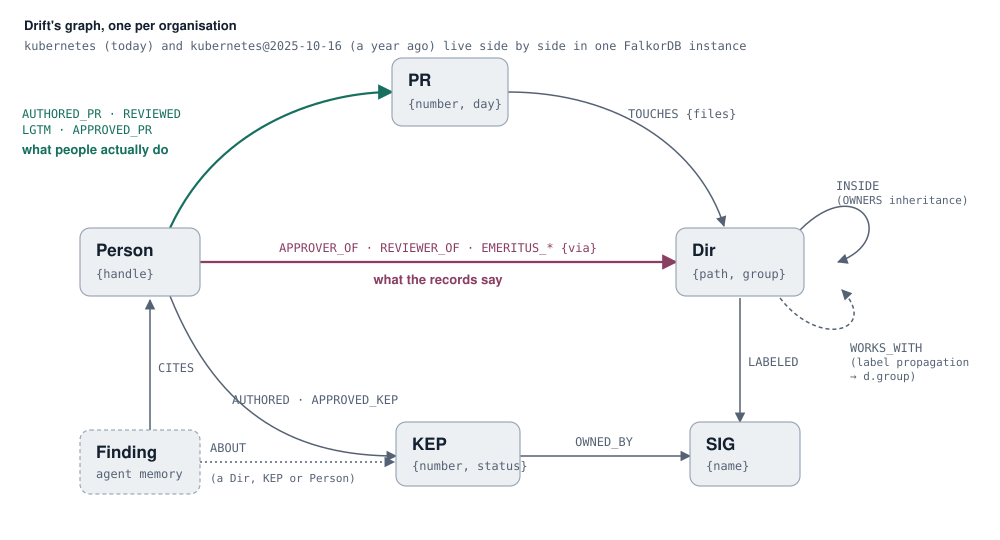

# Drift

[](https://github.com/oscarosk/drift/actions/workflows/ci.yml)

**Your ownership records are already out of date. Drift shows where, proves it, and drafts the fix.**

On 400 recent Kubernetes PRs, Drift's top 3 suggested reviewers included the person who actually
approved the change **78%** of the time. Picking from the OWNERS files: **37%**.

Its 40 drafted OWNERS fixes, applied to a copy of the graph before anyone downloads them, unstick
**12 areas** whose approval requests only reach approvers who've been silent for a year, and leave
**none** stuck (Kubernetes-wide: 19 such areas before, 7 after).

Every large engineering organisation writes down who owns what: CODEOWNERS, OWNERS files, team
pages. Then people move on, new people quietly take over, and the records stop matching reality.
Drift is a company brain built on [FalkorDB](https://www.falkordb.com/) that compares **what the
records say** with **what people actually do**, and shows the graph path behind every answer.

It runs on a real organisation: **Kubernetes**, with 24 teams (SIGs), ~800 people, ~950 owned
directories, ~680 decision records (KEPs) and 6,700+ merged pull requests with their reviews and
approvals, all public.

**Live:** https://drift-egny.onrender.com (free hosting: the first visit after a quiet spell takes about a minute to wake up)

Tracks: **Company Brain** (primary), **Agents That Act on Connected Data**.

<p align="center"></p>

## Does it work? Measured on 400 real PRs

Tested on 400 Kubernetes PRs merged between 2026-07-16 and 2026-10-16. For each one, Drift suggested
reviewers using **only activity from before that PR**, and we checked against who actually typed `/approve`:

| Method | Right person first | Right person in top 3 |
|---|---|---|
| **Drift** (Find a reviewer) | **53%** | **78%** (95% CI 73–81%) |
| Pick from the OWNERS files (what the records say) | 13% | 37% |
| Ask the busiest approvers | n/a | 46% |

OWNERS files don't rank people, so their figures are the exact chance that a pick from the nearest
OWNERS files includes the right approver (today's files, which slightly favours them). Re-run with
`python -m orggraph.eval_reviewers`; results in [`results/reviewer_eval.json`](results/reviewer_eval.json).
If you fetch the data on a different day, expect the figures to move by a point or two.

An earlier run said 86%. That number was wrong: a FalkorDB index bug (below) let activity from after
each PR leak into the prediction. The figure above is after the fix, and `tests/test_eval_no_leak.py`
keeps it that way.

## What it found

Numbers below are produced by `python -m orggraph.backtest` and stored in
[`results/backtest.json`](results/backtest.json).

- **A third of approvers were silent for a year.** On 2025-10-16, 49 of 152 Kubernetes approvers had
  no reviews, `/lgtm`, `/approve` or merged PRs in kubernetes/kubernetes in the previous 12 months.
- **The records did not notice.** A year later, 44 of those 49 were still listed as approvers.
- **The people doing the work show up early.** Ranking non-owners by review activity on
  2025-10-16, the top 30 became reviewers or approvers within a year at **5.3× the base rate**.
- **The real teams don't follow the SIG labels.** Label propagation on who-works-where finds 19
  working groups over 206 areas; 13 of them mix areas labelled with different SIGs (the scheduler's
  group spans areas labelled Scheduling, Node and Instrumentation). The groups predict the future:
  built from activity before 2026-07-16, they put **47%** of the area pairs changed together in later
  PRs in the same group, against **15%** by chance (the highest of 200 shuffles: 19%). See
  [`results/groups.json`](results/groups.json). We also tested whether crossing groups means a PR
  needs more approvers. One download of the data said 3×, another said no difference, so we don't claim it.
- **The organisation is resilient to most single departures, with a few exceptions.** Of the 60 busiest
  active approvers, 50 could step back without leaving any area waiting only on silent approvers. If
  @deads2k stepped back, 6 would (the quota code); see [`results/whatif.json`](results/whatif.json).

Scope note: activity covers merged PRs in kubernetes/kubernetes only. Someone "silent" here may be
active in other Kubernetes repositories, or in work that leaves no PR trail. Drift reports what the
graph shows, not judgements about people.

## Quick start (local)

```bash
docker compose up -d                                  # FalkorDB on :6379, Browser on :3000
pip install -r requirements.txt
cp .env.example .env                                  # add GITHUB_TOKEN (and OPENAI_API_KEY)
python -m orggraph.fetch_reviews --since 2024-10-16   # reviews + approvals via GitHub API (~20 min)
python scripts/build.py                               # downloads public files, builds both graphs, runs the backtest
```

Then run the app:

```bash
uvicorn orggraph.api:app --port 8000      # web UI at http://localhost:8000
python -m orggraph.agent "Who really works on pkg/kubelet/cm/cpumanager?"   # agent from the terminal
python -m orggraph.mcp_server             # MCP server (stdio) for Claude Desktop, Cursor, VS Code
python -m pytest -q tests                 # tests
```

Open http://localhost:3000 (FalkorDB Browser, host `localhost`, port `6379`) to explore the graphs.
With `OPENAI_API_KEY` set, a model picks the tool and writes the sentence; without it, a keyword
router and templates do, so everything works offline.

### MCP

```json
{"mcpServers": {"drift": {"command": "python", "args": ["-m", "orggraph.mcp_server"], "cwd": "/path/to/drift"}}}
```

## Deploy (FalkorDB Cloud + Render)

1. Create a FalkorDB Cloud instance. Put its host, port, username and password in your local `.env`
   and run `python scripts/build.py --no-fetch`: that loads both graphs into the cloud instance.
2. On Render: **New → Blueprint**, pick this repository. `render.yaml` defines the web service; enter
   the same FalkorDB values (and optionally `OPENAI_API_KEY`) when Render asks for them.
3. Public limits are built in: 20 requests per visitor per minute on the busy endpoints, and at most
   `DRIFT_LLM_PER_DAY` model calls a day (after that the keyword router answers). Drift only reads
   Kubernetes data; the only thing visitors write is the agent's memory of its own checked answers.

## Using the app

| Screen | For | What it does |
|---|---|---|
| **Overview** | First visit | The headline drift figure, a live drafted OWNERS change with its evidence, and the areas that drifted most (one dot per approver, hollow if silent). |
| **Find a reviewer** | Contributors, every PR | Paste the files a change touches (or a merged PR number): who to ask first and why, as a path through the graph, the next best people, and which listed owners have gone quiet. |
| **Areas** | Anyone new to a part of the code | Every OWNERS directory, searchable. Each opens *what the OWNERS file says* next to *who actually does the work*, the drafted fix, and a map of the areas that share its people (its working group). |
| **Fix the records** | Maintainers, monthly | Drafted OWNERS fixes for the most drifted directories. Tick the ones you agree with and download one patch: `git apply drift-owners.patch`. Edits keep comments and formatting, are re-parsed and checked before export, and files using `filters:` are left for humans. |
| **How we know** | Skeptics | The three tests (reviewer accuracy, the year-later backtest, the working-group check), their method and the claims we dropped. |

Ask anything from the top bar; answers open beside the page with their graph path, and the queries behind them under *How this was answered*.
The data refreshes by re-running `fetch_reviews` and `build.py` (both incremental-friendly), e.g. weekly.

## How the agent works

1. **A fixed tool catalogue.** The model chooses one of nine tools and fills in arguments; it never
   sees or writes Cypher. Every tool is a hand-written, parameterised query.
2. **Names are resolved first.** A directory, person or KEP is looked up before any traversal runs.
   Typos get suggestions (`pkg/kublet` → `pkg/kubelet`); a file path resolves to the directory whose
   OWNERS file governs it, and the answer says so.
3. **Four kinds of answer:** `answered_with_path`, `answered_from_memory`, `not_in_graph`
   (the thing exists but nothing connects it that way) and `unknown_entity` (no query ran).
4. **Checked sentences.** The model's sentence is rejected if it names a person, directory or KEP the
   graph didn't return, or claims a finding when the result was empty; a template built from the rows
   is used instead.
5. **Memory is more nodes.** Answers are saved as `(:Finding)-[:ABOUT]->(...)`, with `(:Finding)-[:CITES]->(:Person)`
   for everyone they named. Next time, the fresh answer is compared with the remembered one and Drift says
   what changed ("since Oct 17 the answer no longer names @x"). The web app, the CLI agent and the MCP
   server share the same memory, so what one learns the others can `recall`. Because memory sits in the
   same graph as the facts, one query can start in memory and end in facts:
   `MATCH (f:Finding)-[:CITES]->(p:Person)-[:APPROVER_OF]->(d:Dir) RETURN f.text, p.handle, d.path`.
6. **What-if runs on a copy.** `what_if` and `check_fix` copy the graph with `GRAPH.COPY`, edit the copy
   the way the change would, re-run the same routing query on both graphs, diff, and delete the copy.
   The live graph is never written (a test asserts both).

| Tool | What it answers |
|---|---|
| `who_owns(path)` | The OWNERS chain from a directory up to the root, approvers and teams at each level |
| `who_knows(path, months)` | Listed approvers with recent activity (silent if none), and shadow owners |
| `drift_summary(months)` | Share of silent approvers org-wide, and the most drifted directories |
| `route(path, months)` | Who to send new work to, by recent review and approval work, with example PRs |
| `why(kep)` | A decision: authors, approvers, owning SIG, milestones, related KEPs, who is still active |
| `propose_owners_update(path)` | A drafted OWNERS change with evidence for every line (never applied) |
| `suggest_reviewers(paths or pr)` | Who should review a concrete change, across every area it touches; flags when it crosses working groups |
| `working_group(path)` | Areas worked on by the same people (FalkorDB label propagation), their SIG labels and core people |
| `what_if(handles)` | If these people stepped back: areas whose approval would only reach silent approvers, where approval moves up the chain, and who already reviews there (on a `GRAPH.COPY`) |
| `check_fix(dirs)` | Applies the drafted OWNERS changes to a `GRAPH.COPY`: areas unstuck, areas made stuck (API, MCP, Fix the records) |
| `owners_patch(dirs)` | A `git apply`-able patch for drafted fixes (MCP and Fix the records) |
| `recall(path or handle or kep)` | What any client established earlier, with dates and who it named (MCP) |

## Data sources

| Source | What it gives the graph |
|---|---|
| `kubernetes/community/sigs.yaml` | Teams, chairs, tech leads, subprojects and the code they own |
| `kubernetes/kubernetes/**/OWNERS` + `OWNERS_ALIASES` | Approvers, reviewers and past (emeritus) owners of every directory |
| `kubernetes/enhancements/keps/**/kep.yaml` | Decisions: authors, reviewers, approvers, owning team, status, milestones, feature gates |
| git history of `kubernetes/kubernetes` | Every merged PR since Oct 2024 and the files it changed |
| GitHub GraphQL API | Who reviewed each merged PR, and who typed Prow `/lgtm` and `/approve` |

**Privacy:** only public GitHub handles are stored. Names, emails and employers present in
`sigs.yaml` are deliberately not loaded, and no comment text is stored.

## Two graphs, one instance

FalkorDB holds many isolated graphs in one instance. Drift uses that for time travel:

| Graph | OWNERS files | Activity |
|---|---|---|
| `kubernetes` | today | Oct 2024 to today |
| `kubernetes@2025-10-16` | as of 2025-10-16 | only the 12 months before 2025-10-16 |

The backtest runs Drift's queries on the year-ago graph, which never sees the future, and checks
the predictions against today's graph.

## Graph data model

```
(:Person {handle})-[:CHAIR_OF|TECH_LEAD_OF]->(:SIG {id, name, mission})
(:SIG)-[:HAS_SUBPROJECT]->(:Subproject {name})-[:OWNS]->(:Dir {id, repo, path})
(:Person)-[:APPROVER_OF|REVIEWER_OF|EMERITUS_APPROVER_OF|EMERITUS_REVIEWER_OF {via}]->(:Dir)
(:Dir)-[:INSIDE]->(:Dir)          # nearest ancestor with its own OWNERS file (ownership inheritance)
(:Dir)-[:LABELED]->(:SIG)

(:Person)-[:AUTHORED_PR]->(:PR {number, merged, day})   # day = 20260910: integer, see the FalkorDB issue
(:Person)-[:REVIEWED {state}]->(:PR)
(:Person)-[:LGTM]->(:PR)          # Prow /lgtm
(:Person)-[:APPROVED_PR]->(:PR)   # Prow /approve
(:PR)-[:TOUCHES {files}]->(:Dir)  # the OWNERS directory responsible for the changed files
(:Dir)-[:WORKS_WITH {shared, people}]->(:Dir)   # same people work in both (projection for the algorithm)
(:Dir {group, group_name})                        # community from algo.labelPropagation

(:KEP {number, title, status, stage, created, updated, latest_milestone, url})-[:OWNED_BY|INVOLVES]->(:SIG)
(:Person)-[:AUTHORED|REVIEWED_KEP|APPROVED_KEP]->(:KEP)
(:KEP)-[:SEE_ALSO|REPLACES|SUPERSEDED_BY]->(:KEP)
(:KEP)-[:INTRODUCES]->(:FeatureGate {name})-[:AFFECTS]->(:Component {name})
(:KEP)-[:REACHED {stage}]->(:Release {version})

(:Finding {text, tool, at, as_of, session, people})-[:ABOUT]->(:Dir | :Person | :KEP)   # agent memory
(:Finding)-[:CITES]->(:Person)
```

`via` on ownership edges records whether a person is listed directly or through a team alias
(e.g. `sig-node-approvers`), so answers can show *why* someone is an owner.

## Cypher queries the product depends on

**Silent owners of a directory**: listed approvers, with their activity on that directory's
subtree and anywhere. Work under a directory counts for it through `INSIDE*`, the same way
OWNERS inheritance works.

```cypher
MATCH (p:Person)-[:APPROVER_OF]->(d:Dir {path: $path})
OPTIONAL MATCH (p)-[a:AUTHORED_PR|REVIEWED|LGTM|APPROVED_PR]->(pr:PR)-[:TOUCHES]->(:Dir)-[:INSIDE*0..10]->(d)
  WHERE pr.merged >= $since
WITH p, d, count(DISTINCT pr) AS here
OPTIONAL MATCH (p)-[:AUTHORED_PR|REVIEWED|LGTM|APPROVED_PR]->(pr2:PR) WHERE pr2.merged >= $since
RETURN p.handle AS person, here, count(DISTINCT pr2) AS anywhere
ORDER BY here, anywhere
```

**Shadow owners of a directory**: people doing the work who are not listed on it or on any
directory above it.

```cypher
MATCH (d:Dir {path: $path})
MATCH (p:Person)-[a:AUTHORED_PR|REVIEWED|LGTM|APPROVED_PR]->(pr:PR)-[:TOUCHES]->(:Dir)-[:INSIDE*0..10]->(d)
  WHERE pr.merged >= $since
WITH d, p, count(DISTINCT pr) AS prs, collect(DISTINCT type(a)) AS how
WHERE NOT (p)-[:APPROVER_OF|REVIEWER_OF]->(d)
OPTIONAL MATCH (d)-[:INSIDE*1..10]->(up:Dir)<-[:APPROVER_OF|REVIEWER_OF]-(p)
WITH p, prs, how, count(up) AS listed_above
WHERE listed_above = 0
RETURN p.handle AS person, prs, how ORDER BY prs DESC LIMIT 8
```

**Org-wide silent approvers**

```cypher
MATCH (p:Person)-[:APPROVER_OF]->(:Dir)
WITH DISTINCT p
OPTIONAL MATCH (p)-[:AUTHORED_PR|REVIEWED|LGTM|APPROVED_PR]->(pr:PR) WHERE pr.day >= $since_day
WITH p, count(DISTINCT pr) AS n
RETURN count(p) AS approvers, sum(CASE WHEN n = 0 THEN 1 ELSE 0 END) AS silent
```

**Find a reviewer** (per area; ownership inheritance through `INSIDE`, a time window so the
evaluation can ask "what would Drift have said before this PR?")

```cypher
MATCH (d:Dir {repo: 'kubernetes', path: $p})
MATCH (p:Person)-[a:REVIEWED|LGTM|APPROVED_PR]->(pr:PR)-[:TOUCHES]->(:Dir)-[:INSIDE*0..10]->(d)
  WHERE pr.day >= $since_day AND pr.day < $until_day AND NOT p.handle IN $exclude
WITH p, a, pr ORDER BY pr.merged DESC
WITH p, count(DISTINCT pr) AS reviewed,
     sum(CASE WHEN type(a) = 'APPROVED_PR' THEN 1 ELSE 0 END) AS approvals,
     max(pr.merged) AS last, collect(DISTINCT pr.number)[..2] AS examples
RETURN p.handle, reviewed, approvals, last, examples
ORDER BY approvals DESC, reviewed DESC, p.handle LIMIT 8
```

**Working groups** (`orggraph/groups.py`): build the who-works-where projection, then let FalkorDB find communities

```cypher
UNWIND $rows AS r
MATCH (a:Dir {repo: 'kubernetes', path: r.a}), (b:Dir {repo: 'kubernetes', path: r.b})
CREATE (a)-[:WORKS_WITH {shared: r.shared, people: r.people}]->(b);

CALL algo.labelPropagation({nodeLabels: ['Dir'], relationshipTypes: ['WORKS_WITH']})
YIELD node, communityId
RETURN node.path, communityId
```

Every tool's queries are in [`orggraph/tools.py`](orggraph/tools.py), and every answer in the app and
the API carries a trace of the queries it ran.

**What-if, on a copy** (`orggraph/whatif.py`). Copy, edit the copy the way the change would, re-run routing, diff, delete:

```cypher
GRAPH.COPY kubernetes whatif_1a2b3c4d

// on the copy: the people step back, exactly as an OWNERS edit would record it
MATCH (p:Person)-[r:APPROVER_OF]->(d:Dir) WHERE p.handle IN $h
MERGE (p)-[:EMERITUS_APPROVER_OF {via: 'what-if'}]->(d)
DELETE r

// on both graphs: for every OWNERS directory, each level of its chain and who is listed there
MATCH (d:Dir {repo: 'kubernetes'}) WHERE d.has_owners
MATCH chain = (d)-[:INSIDE*0..10]->(o:Dir)
OPTIONAL MATCH (p:Person)-[:APPROVER_OF]->(o)
RETURN d.path, length(chain) AS up, o.path, o.no_parent_owners, collect(DISTINCT p.handle)
ORDER BY d.path, up

GRAPH.DELETE whatif_1a2b3c4d
```

An approval request goes to the nearest level that lists approvers (stopping at `no_parent_owners`);
the area is *stuck* if everyone listed there has been silent for a year.

## A FalkorDB issue we hit

**An index range scan on a string property ignores the upper bound.** We first saw it on graph module
4.18.3 (falkordblite) and confirmed it on the current `falkordb/falkordb:latest` Docker image (graph module 4.22.1). With an
index on `PR.merged` (ISO date strings), `WHERE p.merged >= '2026-09-05' AND p.merged < '2026-09-10'`
returned rows up to `2026-09-19`, and `p.merged < X` alone returned every row. Integer ranges are
correct. Reproduce with `python scripts/repro_falkordb_range.py` (prints `5 / 15 / 5`; all three should be 5).
CI runs it on every push against the latest FalkorDB image, so we'll see when it's fixed. Workaround in Drift: every PR also
stores `day` as an integer (`20260910`), and all date filters use it.

## Honest limits

- Activity is merged PRs in one repository. Reviews on unmerged PRs and work in other repos are not counted.
- Predicting *removal* of silent owners is weak (1.3× chance), because Kubernetes rarely cleans up
  its OWNERS files. We report it anyway; the stale records are the finding.
- OWNERS `no_parent_owners` (which stops inheritance) is applied in `who_owns`, not yet in the activity queries.
- Memory lives in the same graph, so rebuilding the graph clears it.
- The what-if counts an approver as active if they did any review, `/lgtm`, `/approve` or merged PR in kubernetes/kubernetes in the last year; it does not model alias membership changes.
- 50 tests (`pytest`); the ones that need the built graph skip in CI, where only the OWNERS data is loaded.

## Explaining the project

[`docs/EXPLAIN-IT.md`](docs/EXPLAIN-IT.md) walks through the data, the graph model, every key query, the evaluation and the decisions, with the questions a judge is likely to ask.

## Use of AI coding assistants

This project was built with help from Claude (Anthropic) as a coding assistant, as permitted by
rule 11. All design decisions, queries and code were reviewed, run and verified by the author.
